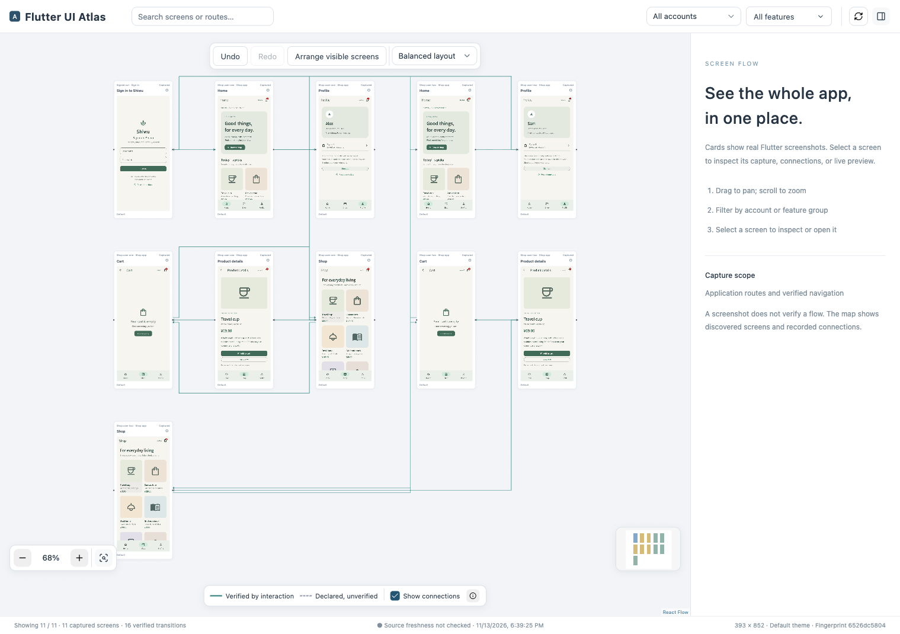

# Flutter UI Atlas

[中文说明](README.zh-CN.md)

A desktop canvas for exploring a Flutter app's routes, accounts, and navigation. Atlas captures your running Flutter Web app in Chrome and places the results on a map you can pan, arrange, and inspect.

Compare accounts and viewports, follow verified transitions, or open a screen in a separate Chrome session to try it yourself. Saved maps remain available after the app stops.



_A real demo capture with a balanced layout and verified navigation across accounts._

## Philosophy

Keep the app ordinary. Atlas connects to an existing Web URL; it needs no SDK, custom entry point, or changes to your widgets. You run the app with your usual tools.

Describe what matters. YAML defines one page per account and route, readiness checks, and navigation actions. Accounts live in a local configuration page. App-specific behavior belongs in a trusted adapter when the standard steps are not enough.

Show what was checked. A screenshot records a screen. A transition is marked `observed` only after a real action reaches the expected route and content. Failed captures keep the last successful map.

## Install

The CLI is built from source for now; there is no published npm release. Use Node.js 26.12.1 (pinned in `.nvmrc`, or another version allowed by `package.json`), pnpm 10.33.0, and an installed Google Chrome. Atlas itself does not need the Flutter SDK.

```sh
git clone https://github.com/szhjia/flutter-ui-atlas.git
cd flutter-ui-atlas
pnpm install --frozen-lockfile
pnpm pack:cli
npm install --global .runtime/packages/flutter-ui-atlas-0.1.0.tgz
atlas --version
```

## Use with your app

Start your Flutter Web app as usual, then run these commands from its project directory:

```sh
atlas init --url http://127.0.0.1:8080/ --ready-text "Welcome"
atlas config   # Set the app URL, authentication, and accounts
atlas build    # Capture the running app
atlas view     # Open the desktop canvas
```

Replace the URL and `Welcome` with your app's address and exact visible text. This is enough to capture its entry screen. For more pages, add a catalog to `.atlas/atlas.yaml` while keeping the settings saved by `atlas config`:

```yaml
routeMode: hash
profiles:
  phone: {width: 393, height: 852}
  tablet: {width: 1024, height: 768}
screens:
  - id: home
    title: Home
    route: /home
    ready:
      all:
        - role: heading
          name: Home
        - role: button
          name: Open settings
  - id: settings
    title: Settings
    route: /settings
    ready: {role: heading, name: Settings}
edges:
  - id: open-settings
    source: home
    target: settings
    action: Open settings
    steps:
      - action: click
        target: {role: button, name: Open settings}
```

Use your app's actual routes and accessible labels. Declare each route once per account; errors, empty/populated content, and other in-page changes do not create additional nodes or navigation edges. `prepare` steps can reproduce a state before capture; `roles` can restrict a page to selected accounts. Build all profiles with `atlas build`, or select one with `atlas build --profile phone` and `atlas view --profile phone`.

On the canvas, drag and lock screens, filter the map, inspect screenshots, and undo layout changes. With a page catalog in place, select a screen to open a live session: Atlas signs in and prepares it in an independent Chrome context, then cleans up the session when it closes.

Everything under `.atlas/` is local: configuration, credentials, snapshots, and generated maps. `atlas init` adds the directory to the app's root `.gitignore`. Enter passwords through `atlas config`; they are stored locally as permission-restricted plaintext, never in YAML. Local URLs are the default; remote development URLs require `allowRemoteUrls: true`.

## Try the demo

The [demo](demo/README.md) is a standalone Flutter shop. Copy it anywhere and run it with standard Flutter commands:

```sh
cd demo
flutter pub get
flutter run -d web-server --web-hostname 127.0.0.1 --web-port 60210
```

Sign in as `user1` or `user2`, both with password `1234.com`. Browse six products, edit a cart, switch accounts, and reload to see local persistence. It has no backend or checkout.

To map it, run `atlas init --url http://127.0.0.1:60210/ --ready-text "Sign in to Shiwu"` in `demo/`, then `atlas config`. The demo README lists the login settings; [the sample catalog](tests/helpers/shop-catalog.yaml) shows pages, preparation, and transitions for phone and tablet. Keep the app URL and account settings from your own configuration.

## Agent skill

The English [flutter-ui-atlas skill](.agents/skills/flutter-ui-atlas/SKILL.md) helps coding agents connect an app, describe its routes, and verify captures. For use in another project, copy its folder into that project's `.agents/skills/` or your agent's skill directory.

## Development

```sh
pnpm dev          # React canvas at http://127.0.0.1:60200; no Flutter SDK needed
pnpm type-check
pnpm test
pnpm test:browser
```

`pnpm dev` starts only the canvas. To test the standalone demo, run `flutter analyze`, `flutter test`, and `flutter build web --no-web-resources-cdn --no-wasm-dry-run` inside `demo/`, then `pnpm test:demo` from the repository root.

`packages/viewer` contains the canvas; `packages/capture` the browser capture and adapter interfaces; `packages/cli` the local workflow. The Flutter package in `packages/flutter_ui_atlas` is an optional compatibility SDK.

Detailed [protocol](docs/协议与适配接口.md) and [architecture](docs/架构与接入指南.md) notes are currently in Chinese.

## Built with

- [React Flow](https://reactflow.dev/) (`@xyflow/react`) provides the node-and-edge canvas: screen nodes, navigation edges, pan, zoom, and selection. It is the foundation of the Viewer.
- [React](https://react.dev/) powers the Viewer and configuration page.
- [shadcn/ui](https://ui.shadcn.com/) supplies the Viewer Header controls, popovers, and tooltips, built on Radix primitives. [Lucide](https://lucide.dev/) provides their icons.
- [Playwright](https://playwright.dev/) drives Chrome for captures, login checks, and live sessions.
- [Tabler Icons](https://tabler.io/icons) supplies the configuration page icons.

## Star history

[](https://www.star-history.com/#szhjia/flutter-ui-atlas&Date)

## Account workspaces and reusable builds

The canvas shows one account at a time. Each account has its own layout, viewport, selection, and live session. Public sign-in pages share their original capture evidence, while navigation stays within the selected account. Account names can change without changing their UUIDs.

For standard `.atlas/atlas.yaml` projects, `atlas build` reuses successful account/profile revisions when their declared inputs and resource checksums match. It preserves the original capture IDs and times and does not launch Chrome on a complete cache hit. Use `atlas build --force` to capture current runtime data again. Source fingerprints cannot prove that server data, authentication, or the running Web build stayed unchanged. A reused map is historical evidence, not a new verification.

Inputs include page declarations, readiness and navigation steps, authentication, account credentials, browser channel, viewport, and source content. `sourceFiles` paths remain relative to `.atlas/atlas.yaml` and may name files or directories. Without an explicit list, Atlas covers `lib/`, `web/`, dependency declarations, local assets/fonts, and project-local path dependencies. Unsupported external or symbolic inputs disable reuse. Git is not required; HEAD alone never decides reuse. Custom adapters and discovery continue to capture rather than claiming a cache hit with incomplete inputs.

Authentication modules use Node file URL rules for relative ESM imports, including percent-encoded filenames. Importing `node:module` disables cache reuse and live sessions from captured snapshots: `createRequire` can load dependencies through arbitrary aliases that the static ESM graph cannot verify. Non-`.mjs` authentication dependencies also disable reuse because their module format or CommonJS dependencies are not fully tracked. Fresh captures through a new CLI process remain supported. Within one build snapshot, the same adapter can serve multiple pages and accounts. Atlas tracks loaded authentication dependencies by their real file paths and requested-path-to-target resolution across entry modules. File and directory symlinks inside declared module paths disable reuse; retargeting a loaded dependency requires restarting the service even within the same build scope. The configuration directory is canonicalized before resolving declared module paths. Changed shared dependencies require a service restart. Since an incomplete graph may populate Node’s cache outside its visible dependencies, module authentication cannot cross operation scopes after such a graph is loaded; loading an incomplete graph after another operation also requires a restart. Restart the Atlas service before testing again, or use fully tracked `.mjs` dependencies.

Successful revisions are immutable. One application index switches only after every required account/profile in the command succeeds. A failed build keeps the previous index. All configuration, cache records, credentials, captures, and indexes remain private under `.atlas/`.

Set an optional `pageName: LoginPage` on a page declaration to show the application's actual page name. Atlas displays this declared value; it does not infer Dart class names. Without `pageName`, the existing page title is used. Cards show the page name, route, and screenshot; capture diagnostics remain in the details panel.

Run `atlas doctor` to check the installed Node runtime, package dependencies, prebuilt Viewer, Chrome, configured application URL, and source coverage. The installed package provides Playwright and YAML libraries, but requires a compatible Node.js runtime and an installed Google Chrome. It does not download browsers or run Flutter. A cache hit and offline viewing do not require a running application; a fresh capture and live session do.
