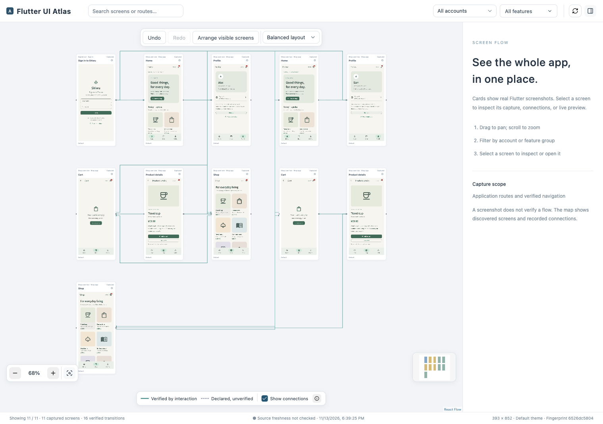

# Flutter UI Atlas

[English](README.md)

把真实 Flutter 应用的路由、账户和导航整理到一张桌面画布上。Atlas 通过 Chrome 采集已运行的 Flutter Web 应用，生成可以拖动、缩放和查看截图的页面地图。

每个账户的同一路由只对应一个页面节点；错误提示、空态／有数据等页面内变化不会新增节点或导航连线。

你可以对比不同账户与视口，查看经过验证的导航，也可以在独立 Chrome 会话中打开某个页面直接操作。应用停止后，已保存的地图仍然可以查看。



_独立商城 Demo 的实际画布：以均衡布局对比不同账户的路由页面与已验证导航。_

## 设计取舍

**让应用保持普通。** Atlas 连接已有 Web 地址，无需 SDK、专用入口或修改组件。应用仍由你熟悉的工具启动和构建。

**声明需要查看的内容。** 用 YAML 按账户和路由声明页面、就绪条件和导航操作，在本机配置页管理账户。标准步骤无法覆盖的应用差异，交给可信适配器处理。

**明确证据的范围。** 截图记录页面；只有真实操作到达预期路由和内容，连线才标记为 `observed`。采集失败时保留上一次成功的地图。

## 安装

目前从源码构建 CLI，尚未发布 npm 包。需要 Node.js 26.12.1（`.nvmrc` 固定版本，也可使用 `package.json` 允许的其他版本）、pnpm 10.33.0 和本机 Google Chrome。Atlas 自身不需要 Flutter SDK。

```sh
git clone https://github.com/szhjia/flutter-ui-atlas.git
cd flutter-ui-atlas
pnpm install --frozen-lockfile
pnpm pack:cli
npm install --global .runtime/packages/flutter-ui-atlas-0.1.0.tgz
atlas --version
```

## 接入应用

按平时的方式启动 Flutter Web，再在应用工程目录运行：

```sh
atlas init --url http://127.0.0.1:8080/ --ready-text "Welcome"
atlas config   # 设置应用地址、认证方式和账户
atlas build    # 采集已运行的应用
atlas view     # 打开桌面画布
```

把地址和 `Welcome` 换成应用的实际地址及准确可见文字，即可采集入口页面。需要多页面时，在 `.atlas/atlas.yaml` 中添加声明，保留配置页保存的设置：

```yaml
routeMode: hash
profiles:
  phone: {width: 393, height: 852}
  tablet: {width: 1024, height: 768}
screens:
  - id: home
    title: Home
    route: /home
    ready:
      all:
        - role: heading
          name: Home
        - role: button
          name: Open settings
  - id: settings
    title: Settings
    route: /settings
    ready: {role: heading, name: Settings}
edges:
  - id: open-settings
    source: home
    target: settings
    action: Open settings
    steps:
      - action: click
        target: {role: button, name: Open settings}
```

路由与标签要使用应用的真实值。`prepare` 可在采集前复现状态，`roles` 可限定页面所属账户。`atlas build` 采集全部视口，也可使用 `atlas build --profile phone` 和 `atlas view --profile phone` 选择一个视口。

画布支持拖动、锁定、筛选、截图查看和布局撤销。添加页面声明后，选中已采集页面可打开实时会话，Atlas 在独立 Chrome 上下文中完成登录与状态准备，并在会话关闭后清理资源。

`.atlas/` 下的配置、凭据、快照和地图都属于本机数据。`atlas init` 会在应用根 `.gitignore` 中忽略该目录。密码通过 `atlas config` 录入，以受限权限明文保存在本机，不写入 YAML。默认连接本机地址；远程开发地址需要设置 `allowRemoteUrls: true`。

## 运行 Demo

[Demo](demo/README.md) 是可独立复制的普通 Flutter 商城，界面与文档使用英文：

```sh
cd demo
flutter pub get
flutter run -d web-server --web-hostname 127.0.0.1 --web-port 60210
```

账户为 `user1`、`user2`，密码均为 `1234.com`。可浏览六件商品、修改购物车、切换账户并刷新恢复。没有后端或结算。

在 `demo/` 内运行 `atlas init --url http://127.0.0.1:60210/ --ready-text "Sign in to Shiwu"`，再运行 `atlas config`。登录设置见 Demo README；[示例目录](tests/helpers/shop-catalog.yaml) 包含手机与平板的页面、状态准备及导航操作。合并目录时保留自己的应用地址和账户配置。

## Agent 技能

英文 [flutter-ui-atlas 技能](.agents/skills/flutter-ui-atlas/SKILL.md) 用于协助 Agent 接入应用、声明路由并验证采集。其他项目可将整个技能目录复制到 `.agents/skills/` 或所用 Agent 的技能目录。

## 开发

```sh
pnpm dev          # 画布地址 http://127.0.0.1:60200，无需 Flutter SDK
pnpm type-check
pnpm test
pnpm test:browser
```

`pnpm dev` 只启动画布。Demo 验证先在 `demo/` 中运行 `flutter analyze`、`flutter test`、`flutter build web --no-web-resources-cdn --no-wasm-dry-run`，再从根目录运行 `pnpm test:demo`。

`packages/viewer` 为画布，`packages/capture` 为浏览器采集和适配接口，`packages/cli` 为本机工作流。`packages/flutter_ui_atlas` 是可选兼容 SDK。

详细内容见[协议与适配接口](docs/协议与适配接口.md)及[架构与接入指南](docs/架构与接入指南.md)。

## 主要开源依赖

- [React Flow](https://reactflow.dev/)（`@xyflow/react`）：Viewer 的画布基础，提供页面节点、导航连线、平移、缩放与选择。
- [React](https://react.dev/)：构建画布与配置页。
- [Playwright](https://playwright.dev/)：驱动 Chrome 采集、登录测试与实时会话。
- [shadcn/ui](https://ui.shadcn.com/)：Viewer Header 的基础控件、弹层和提示，交互基于 Radix；图标使用 [Lucide](https://lucide.dev/)。
- [Tabler Icons](https://tabler.io/icons)：配置页图标。

## Star History

[](https://www.star-history.com/#szhjia/flutter-ui-atlas&Date)

## 账户工作空间与构建复用

画布任意时刻只显示一个账户，布局、镜头、选择与实时会话按账户隔离。公共登录页引用原始截图，关联导航不会进入其他账户。

标准 YAML 工程的 `atlas build` 在输入和产物校验一致时复用上次成功版本，保留原采集 ID 与时间；`atlas build --force` 重新采集。缓存命中不启动 Chrome。Git HEAD 不是唯一依据，无 Git 时仍使用内容指纹。源码未变不能证明运行中的 Web 产物、远端数据或认证状态未变，复用图谱明确属于历史证据。

`sourceFiles` 相对 YAML 目录解析，可指定文件或目录；默认覆盖源码、Web 文件、依赖声明、资源与字体及项目内 path 依赖。无法完整覆盖的外部或符号链接输入禁用复用。整次命令的账户与视口统一发布，失败保留旧索引。

页面可声明 `pageName: LoginPage`，工具不猜测 Dart 类名。`atlas doctor` 检查安装依赖、Chrome、应用可达性和源码覆盖。安装包包含 Playwright/YAML 和预构建 Viewer，本机仍需 Node 与 Chrome；Atlas 不下载浏览器，不启动 Flutter。
